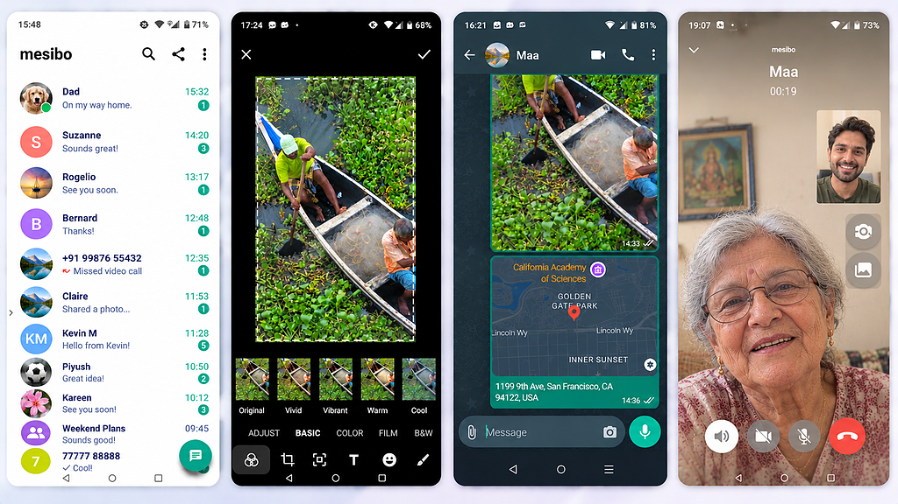

# Mesibo Messenger for Android

Mesibo Messenger is an open-source real-time messaging, voice & video calling, and conferencing application. This repository contains the source code for the **Mesibo Messenger App for Android**.

It is built on [mesibo APIs](https://mesibo.com). mesibo is completely free for development and non-commercial projects.

---

## 🌐 Messenger Source Code Repositories

Mesibo Messenger Source Code is available across various native and hybrid platforms, alongside its backend components:

### Android
* **Android (Java):** [https://github.com/mesibo/messenger-app-android](https://github.com/mesibo/messenger-app-android)
* **Android (Kotlin):** [https://github.com/mesibo/messenger-app-android-kotlin](https://github.com/mesibo/messenger-app-android-kotlin) (converted from Java in Android Studio)

### iOS
* **iOS (Swift):** [https://github.com/mesibo/messenger-app-ios-swift](https://github.com/mesibo/messenger-app-ios-swift)
* **iOS (Objective-C):** [https://github.com/mesibo/messenger-app-ios](https://github.com/mesibo/messenger-app-ios)

### Web
* **Web Messenger:** [https://github.com/mesibo/messenger-javascript](https://github.com/mesibo/messenger-javascript)

### Flutter (Android & iOS)
* **Flutter (Android & iOS):** [https://github.com/mesibo/messenger-app-flutter](https://github.com/mesibo/messenger-app-flutter)

### Server Side APIs for Messenger
* **Messenger APIs:** [https://github.com/mesibo/messenger-app-backend](https://github.com/mesibo/messenger-app-backend)

---

## ✨ Features

* **Messaging:** One-on-one messaging and Group chat.
* **Voice & Video:** High-quality voice and video calling + multi-party conferencing.
* **Multi-Device Sync:** • Ability to log in from multiple devices, with messages and calls synchronized across all logged-in devices in real time.
* **Multi-Device Calling:** Incoming calls can be delivered to multiple logged-in devices, allowing users to answer from any device.
* **Rich Media & Image Editing:** Share text, video, audio, and arbitrary files, featuring a built-in image editor to adjust visuals before sending.
* **Message Status & Typing Indicators:** Real-time message status (sent, delivered, read) and typing indicators.
* **Real-Time Profile Updates::** Broadcast profile changes such as profile picture, status, and description in real time.
* **Security:** End-to-End Encryption (E2EE) built-in.
* **Geolocation:** Real-time location sharing.
* **Presence:** Online/offline status indicators.
* **Notifications:** Integrated with Google and Apple push notification services.

---

## 🔑 Compiling, Setting Up and Running the Demo

For comprehensive setup steps, refer to our multi-part tutorial guide:  
👉 **[Build a fully featured WhatsApp clone using Mesibo](https://docs.mesibo.com/tutorials/open-source-whatsapp-clone/)**

The documentation covers:
* Compilation & platform-specific configuration instructions.
* How to download backend source code and host your private API server.
* Hosting the entire real-time messaging, voice, and video platform on-premise.
* Customizations guidelines.

